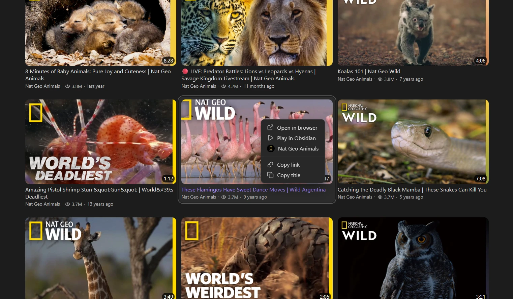
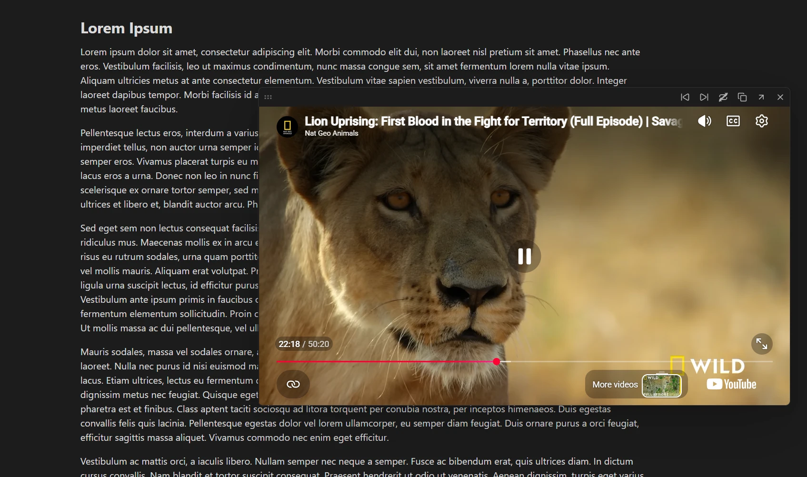
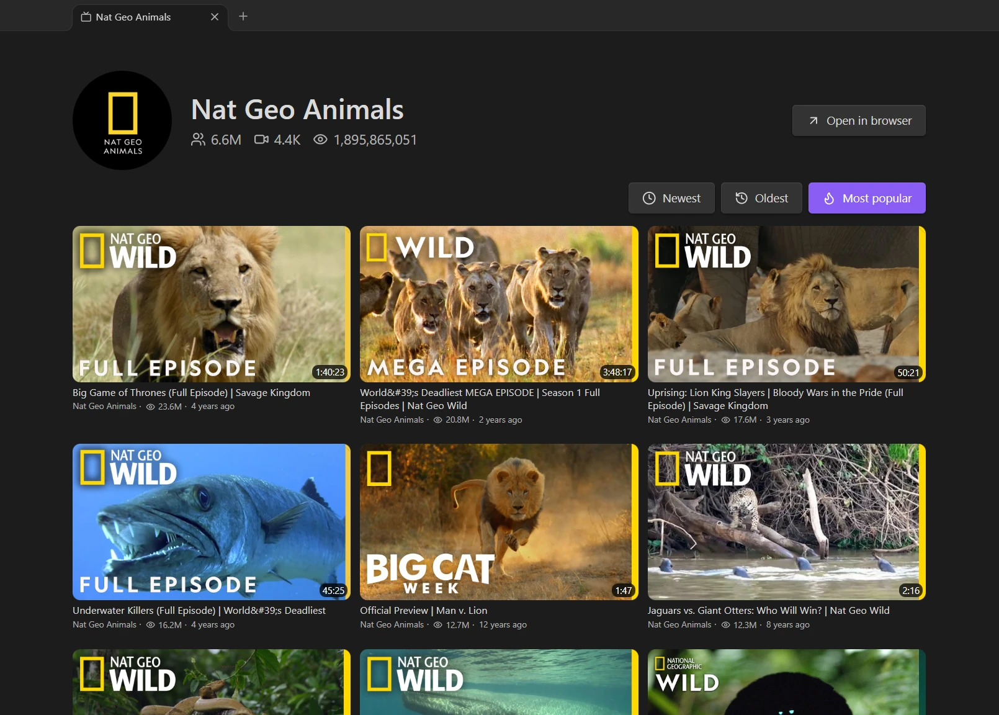

### Your YouTube links, as a thumbnail gallery

YouTube links turn into a clean gallery with titles, channels, views and more.



### Watch videos without leaving your notes

Play any video in a floating player that you can drag and resize.



### A dedicated page for every channel

Open a channel in its own tab, with details and sortable videos.



### Highlights

- **Thumbnail galleries** from plain video links, with titles, channels, views and durations.
- **Channel cards and playlists** from channel and playlist links, with a "Load more" button for long playlists.
- **Floating video player** you can drag, resize and keep open while you work.
- **Channel pages** that open in their own tab, sortable by newest, oldest or most popular.
- **Works out of the box.** No account or API key needed; an optional free key unlocks extra details.

### Features

#### Galleries
- Consecutive video links become a thumbnail gallery. Links in a list work too.
- Channel links (`@handle`, `/channel/ID`, `/c/name`, `/user/name`) become profile cards with subscriber and video counts.
- Playlist links become a header (title, creator, video count, views, description) above a gallery of the playlist's videos.
- Vertical or horizontal layouts, 1 to 4 videos per row, spacing, title size, title lines, hover effects and optional icons for statistics.
- Works well on mobile, with the same layout settings as on desktop. If you sync your vault, it is recommended not to sync this plugin's settings, so you can keep different settings on your phone and your computer: with Obsidian Sync, leave community plugin syncing off (the default); with Git, add `.obsidian/plugins/advanced-youtube-features/data.json` to your `.gitignore`.

#### Player
- Play videos in a small floating window. Drag it by the top bar and resize it from the sides or bottom; the video keeps its proportions.
- Previous and next buttons, copy link, open in browser, and **autoplay** to continue with the next video of the gallery or playlist.
- `Ctrl` / `Cmd` + click opens the browser instead.

#### Channel pages
- Open a channel in its own tab inside Obsidian, with its details and a gallery of its videos.
- Sort by newest, oldest or most popular.

#### Right-click menu
- Open in browser, play in Obsidian, copy link or title, and open the video's channel page.

#### Tools
- Paste a lone YouTube link and get a titled Markdown link automatically.
- Add titles to bare YouTube links across your vault.
- Shorten video links to `youtu.be/ID` (start times are kept).

#### Installation

**From Community plugins**

1. Open **Settings → Community plugins** and turn off Restricted mode.
2. Select **Browse**, search for **Advanced YouTube Features**, then **Install** and **Enable**.

**Manually**

1. Download `main.js`, `manifest.json` and `styles.css` from the latest release.
2. Put them in `<your vault>/.obsidian/plugins/advanced-youtube-features/`.
3. Reload Obsidian and enable the plugin under **Settings → Community plugins**.

#### Usage

Put YouTube links on their own lines:

```markdown
https://youtu.be/dQw4w9WgXcQ
https://youtu.be/9bZkp7q19f0

https://www.youtube.com/@channelname

https://www.youtube.com/playlist?list=PLxxxxxxxxxxxx
```

Markdown links work as well, and their text is used as the title:

```markdown
[My favourite talk](https://youtu.be/dQw4w9WgXcQ)
```

Switch the note to Reading View to see the galleries. All options are under **Settings → Advanced YouTube Features**.

#### Optional YouTube Data API key

Everything basic works without a key. A free YouTube Data API key adds:

- view counts, durations and publish dates on video cards
- total duration of playlists (all videos, even those not loaded) and of galleries
- a channel's exact total views on its page
- reliable newest / oldest / most popular sorting on channel pages and full playlist data

To get one, use the links under **YouTube API** in the settings to enable the YouTube Data API and create an API key, paste it in, and select **Test key**.

Without a key, channel page sorting and playlist details are read from YouTube's public pages on a best-effort basis. YouTube can change those pages, so some details may occasionally be missing.

#### Network use and privacy

The plugin needs the internet to show YouTube data. It contacts:

- `i.ytimg.com` for thumbnails
- `www.youtube.com` (oEmbed, public channel, playlist and video pages) for titles, channel and playlist details
- `www.googleapis.com` (YouTube Data API) only if you add an API key
- `www.youtube-nocookie.com` for the player, only when you play a video in Obsidian

Fetched details are cached in the plugin's data file so they aren't requested again. There is no analytics or tracking. Your API key, if you add one, is stored **unencrypted** in the plugin's `data.json`, so don't commit it to a public repository or share that file.

**Saved data:** details fetched from YouTube (titles, channels, playlists, durations) are cached for at most 28 days, then removed and fetched again, in line with YouTube's API policy on stored data. Your API key stays until you remove it.

#### Limitations

- Galleries show in Reading View only, not in Live Preview or Source mode.
- Private and deleted videos are shown as unavailable.

#### Support

Found a bug or have a suggestion? Email [contact@kgniewek.com](mailto:contact@kgniewek.com).

If you enjoy the plugin, you can [buy me a coffee](https://buymeacoffee.com/kgniewek).

#### Disclaimer

This is an independent project. It is **not affiliated with, endorsed by or sponsored by YouTube or Google**. YouTube is a trademark of Google LLC. Videos play in YouTube's own embedded player, and you are responsible for using the plugin in line with YouTube's Terms of Service.

#### License

Copyright (c) 2026 Krzysztof Gniewek. All rights reserved. The source is visible for transparency, but copying, modifying or redistributing it is not permitted. See [LICENSE](LICENSE).
